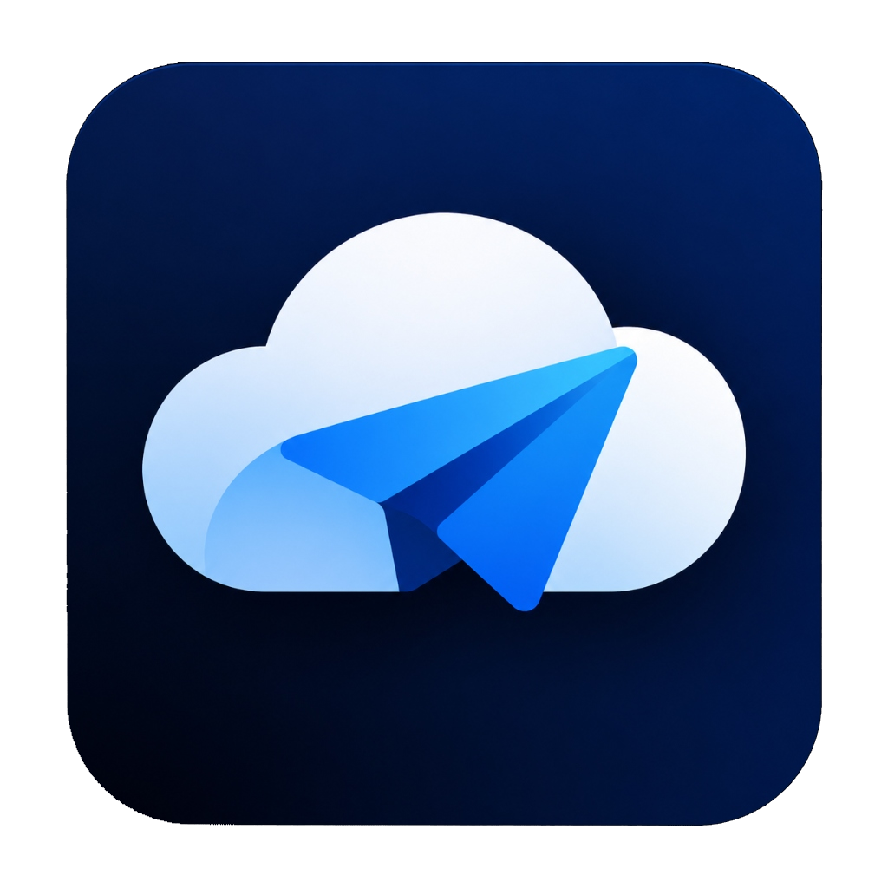

<div align="center">



# TeDrive

### **Your personal unlimited cloud, powered by your Telegram account.**

A full-featured personal cloud drive and photo library that keeps your files securely in your own private Telegram channel.<br>
**Zero monthly fees. Zero third-party cloud servers. Nothing to host or maintain.**

[**Download v2.0.0**](https://github.com/nitheeshmk41/TeDrive/releases) · [**Launch Web App**](https://tedrive.vercel.app) · [**How it works**](#how-it-works)

<p align="center">
  
  
  
  
  
  
</p>

</div>

---

## ✨ Why TeDrive?

Phones run out of storage fast, and traditional cloud subscriptions charge you month after month. Telegram already provides free, unlimited cloud storage for files up to **2 GB each** (or 4 GB with Telegram Premium).

**TeDrive transforms that storage into a polished, modern cloud drive**:
- **Native photo & video gallery** organized chronologically.
- **Instant mobile link copying & sharing**: copy a direct download link to clipboard with one tap or share it via WhatsApp and messaging apps without re-downloading gigabytes of data.
- **Smart background backup** with Wi-Fi only mode and automatic duplicate detection.
- **"Free up space"**: safely delete local media once Telegram confirms an identical SHA-256 fingerprint is backed up.
- **Cross-platform real-time sync**: see and access your files instantly on Android, Windows, Web, Linux, and macOS.

---

## 🚀 Key Features

| Feature | Description |
| :--- | :--- |
| 🔗 **1-Tap Mobile Link Copy & Share** | Copy public Telegram links directly to your clipboard or send via messaging apps without downloading huge files first. |
| 📸 **Automatic Phone Backup** | Seamlessly backs up camera photos, screenshots, and WhatsApp media in the background (configurable Wi-Fi and charging filters). |
| 🧹 **Safe Space Reclaim** | Reclaim phone memory with confidence: removes local files only after cryptographic SHA-256 checksum verification. |
| 🖼️ **Full Media Gallery** | Timeline view grouped day-by-day and month-by-month, albums, quick search, category filters, and sorting. |
| ▶️ **Fast Streaming Previews** | High-performance viewer with pinch-to-zoom for photos and instant streaming playback for videos and music. |
| 🔒 **Private by Design** | Files are stored in your own private `TeDrive Storage` channel. Only files you explicitly share are posted to a public link. |
| 📥 **System Integration** | On Android, TeDrive integrates into the Android Share Sheet and the system file picker. |
| 💻 **Universal Access** | Sign in once with your phone number on any device (phone, desktop, browser) and get full real-time access. |

---

## 📦 Downloads (v2.0.0)

Download pre-built binaries from the [**GitHub v2.0.0 Release**](https://github.com/nitheeshmk41/TeDrive/releases/tag/v2.0.0):

| Platform | Download Package | Notes |
| :--- | :--- | :--- |
| **Android (Phone/Tablet)** | [**TeDrive-v2.0.0-android-arm64.apk**](https://github.com/nitheeshmk41/TeDrive/releases/download/v2.0.0/TeDrive-v2.0.0-android-arm64.apk) | Recommended for modern Android phones (ARM64) |
| **Android (32-bit)** | [**TeDrive-v2.0.0-android-arm32.apk**](https://github.com/nitheeshmk41/TeDrive/releases/download/v2.0.0/TeDrive-v2.0.0-android-arm32.apk) | For older 32-bit Android devices |
| **Windows** | [**TeDrive-v2.0.0-windows-x64.zip**](https://github.com/nitheeshmk41/TeDrive/releases/download/v2.0.0/TeDrive-v2.0.0-windows-x64.zip) | Windows 10 & 11 (Extract and run `TeDrive.exe`) |
| **Web App** | [**Launch tedrive.vercel.app**](https://tedrive.vercel.app) | Runs TDLib directly in browser via WebAssembly |
| **Linux** | [**TeDrive-v2.0.0-linux-x64.tar.gz**](https://github.com/nitheeshmk41/TeDrive/releases/download/v2.0.0/TeDrive-v2.0.0-linux-x64.tar.gz) | Ubuntu 22.04+, Debian, Fedora (Run `TeDrive/tedrive`) |
| **macOS** | [**TeDrive-v2.0.0-macos-arm64.dmg**](https://github.com/nitheeshmk41/TeDrive/releases/download/v2.0.0/TeDrive-v2.0.0-macos-arm64.dmg) | Apple Silicon. Open, drag to Applications; right-click → Open the first time |

---

## ⚡ Quick Start (2 Minutes)

All you need is a Telegram account and a free Telegram API credential pair:

1. Visit [**my.telegram.org**](https://my.telegram.org) and sign in with your Telegram phone number.
2. Click **API development tools**.
3. Create an app (set title/short name to `TeDrive`).
4. Copy your **App api_id** and **App api_hash**.
5. Launch TeDrive, paste your `api_id` and `api_hash`, and verify with the login code sent to your Telegram app.

> **Tip**: Sign in with the exact same phone number across your phones, tablets, PCs, and web browsers to instantly access your synced drive!

---

## 🛠️ Architecture & Security

```
 📱 Android Phone ──┐
 💻 Windows/Mac/Linux ┼──► Official TDLib ──► Telegram Cloud ──► "TeDrive Storage" (Private Channel)
 🌐 Web (WASM) ─────┘                                       └──► "TeDrive Shared"  (Public Links)
```

- **Official TDLib Engine**: TeDrive communicates with Telegram using TDLib (Telegram Database Library) compiled natively with C++/FFI on mobile and desktop, and WebAssembly (`tdweb`) on the web.
- **Zero Intermediary Servers**: All data travels strictly between your client device and Telegram's official cloud servers. TeDrive operates with no proprietary backend, no tracking, and no telemetry.
- **Self-Healing Metadata**: File metadata (checksums, albums, creation timestamps, device names) are embedded cleanly into message captions. If you ever switch devices or reinstall the app, your entire cloud drive reconstructs itself automatically from Telegram.
- **Local Credential Storage**: On Android, your session and encryption keys are safeguarded in the hardware-backed Android Keystore.

---

## 💻 Development

TeDrive is built with Flutter and Dart.

```bash
cd app
flutter pub get
flutter run          # Runs on connected Android device or desktop
dart test            # Runs full test suite
```

### Directory Structure

```
app/
├── lib/
│   ├── td/                 # TDLib FFI bindings (Mobile/Desktop) & WebAssembly bridge (Web)
│   ├── tedrive_service.dart# Authentication, uploads, downloads, channel management
│   ├── drive_controller.dart# Drive file tree, streaming, upload queue, live sync
│   ├── backup_controller.dart # Automated phone media backups & space manager
│   ├── stored_file.dart    # File model & caption metadata serialization
│   └── ui/                 # Responsive Flutter UI (Mobile, Tablet, Desktop)
└── android/                # Android native foreground services & content providers
```

---

## 📄 License

This project is licensed under the [MIT License](LICENSE).

*Disclaimer: TeDrive is an independent open-source project that utilizes the official Telegram API. It is not affiliated with, sponsored by, or endorsed by Telegram FZ-LLC.*
