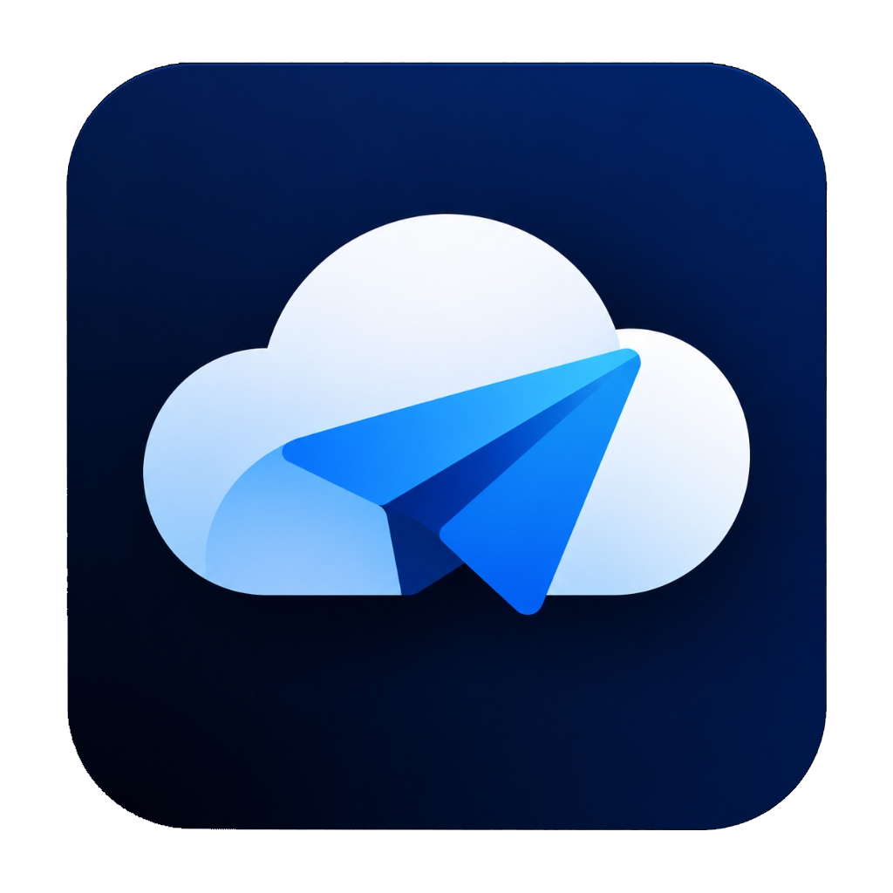

<div align="center">



# TeDrive

**A personal cloud drive and photo library that stores everything in your own Telegram account.**

No subscription. No TeDrive server. Your files stay in a private channel only you can see.

[**Download**](https://github.com/nitheeshmk41/TeDrive/releases/latest) · [**Open the web app**](https://tedrive.vercel.app) · [**Install guide**](docs/install.md) · [**User guide**](docs/user-guide.md)


</div>

---

## Why TeDrive

Phones fill up, and cloud plans charge every month. Telegram already stores files up to 2 GB each for free. TeDrive turns that storage into a real drive: a photo timeline, folders, phone backup and sharing, on every device you own.

## Features

| | |
| :--- | :--- |
| 📸 **Photo library** | Day-by-day timeline, "On this day" memories, a map of where photos were taken, EXIF details |
| 🔎 **Smart search** | Find photos by what is in them ("cat", "beach", "food"), even when the file is called image.png, and by related words ("kitten", "sea"). Also by text inside them, month, year or album. Smart albums for People, Selfies, Groups, Text and common things. All worked out on the phone |
| 🎞️ **Videos** | A Videos row in Albums: all videos, or the videos of one album |
| 📁 **Drive** | Nested folders, multi-select, starred, recent, large files, duplicates, Trash with 30-day restore |
| 🔄 **Phone backup** | Backup of chosen albums instantly, daily or weekly (Wi-Fi or charging only), then **Free up space** safely |
| 🧩 **Widgets** | **TeDrive photos** shows your photos, a new one every half hour, each time you leave TeDrive, or when you tap its button. Choose all photos, one person (your face, say), people, starred, a thing or an album; tap the photo to open it. Also backup status, storage and overview widgets with **Back up now** |
| 🙂 **Faces** | Faces that look alike are grouped on the phone, so the photo widget can show one person. No names, nothing uploaded |
| 📦 **Export** | Download the whole drive as .zip files, so you are never locked in |
| 📤 **Sharing** | Send files to any app, forward to a Telegram chat with no data used, send a smaller photo, or zip a whole folder |
| 🔐 **Vault** | Documents encrypted on your device before upload; even Telegram cannot read them |
| 🔒 **App lock** | PIN or fingerprint |
| 📶 **Wi-Fi transfer** | Phone to laptop over local Wi-Fi with a QR code |
| ⬆️ **Updates** | The app offers new versions, downloads them in the background (you can leave the app) and installs them over the old one: sign-in, files and settings stay. If something new misbehaves, TeDrive pauses only that part and keeps working |
| 💻 **Everywhere** | Android, Windows, macOS, Linux and the browser, all in sync |

## Download

| Platform | File |
| :--- | :--- |
| Android (most phones) | [**TeDrive-android-arm64.apk**](https://tedrive.vercel.app/download/TeDrive-android-arm64.apk) |
| Android (old 32-bit phones) | [TeDrive-android-arm32.apk](https://tedrive.vercel.app/download/TeDrive-android-arm32.apk) |
| Windows 10/11 | `TeDrive-…-windows-x64.zip` |
| macOS (Apple Silicon) | `TeDrive-…-macos-arm64.dmg` |
| Linux x64 | `TeDrive-…-linux-x64.tar.gz` |
| Browser | [tedrive.vercel.app](https://tedrive.vercel.app) |

The Android links always give the newest version. All files are also on the [latest release](https://github.com/nitheeshmk41/TeDrive/releases/latest). Step-by-step instructions, including what to do if a download stops at 100%, are in the [install guide](docs/install.md).

## Updating

On Android, TeDrive checks for a new version when it starts. Tap **Update**: the download carries on in the background, with its progress in the notification bar. When it is ready, tap **Install now** (or the notification), then **Update**. Android closes TeDrive for a few seconds while it installs; that is normal. A **TeDrive updated** notification opens it again.

Versions before v3.3.1 were signed with a different key and need one uninstall and reinstall; the app walks you through it. Your files are in Telegram and are not affected.

If TeDrive closes unexpectedly twice in a short time, it starts with the newer extras (looking inside photos, faces, the photo widget) paused, so the rest of the app keeps working. **Account → Copy error log** gives the reason, to report it.

## Quick start

1. Get a free API ID and hash at [my.telegram.org](https://my.telegram.org) → **API development tools**.
2. Open TeDrive, paste them, and sign in with your phone number.
3. Sign in with the same number on your other devices to see the same files.

## How it works

```
Android · Windows · macOS · Linux · Web
                │
          TDLib (Telegram's official library)
                │
Telegram ──► "TeDrive Storage"  private channel, one message per file
```

File details (fingerprint, folder, date, location) are kept in each message's caption, so the whole drive rebuilds itself on any device. More in [docs/architecture.md](docs/architecture.md).

## Documentation

- [Install and update](docs/install.md)
- [User guide](docs/user-guide.md)
- [Building from source and releasing](docs/building.md)
- [Architecture](docs/architecture.md)
- [Changelog](CHANGELOG.md)
- [Contributing](CONTRIBUTING.md)

## License

[MIT](LICENSE). TeDrive is an independent project that uses the Telegram API. It is not affiliated with or endorsed by Telegram.

> Keep a second copy of anything irreplaceable. Telegram is not a contracted storage service.
